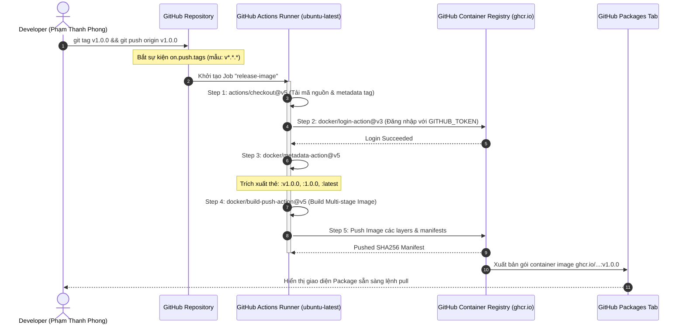

# Báo cáo Bài tập 2: Tự động hóa đóng gói và phát hành Docker Image khi gắn Git Tag (v*.*.*)

- **Sinh viên:** Phạm Thanh Phong
- **MSSV:** N24DTCN120
- **Lớp:** IT209
- **Học phần:** IT209
- **Session:** 12
- **Bài tập:** 02 (BT2)
- **Tệp nộp bài:** [.github/workflows/release.yml](./.github/workflows/release.yml), [screenshots/github-packages-docker-v1.0.0.png](./screenshots/github-packages-docker-v1.0.0.png), [README.md](./README.md)
- **Đường dẫn trên GitHub:** `homework/session_12/ex2/`
- **Trạng thái:** Hoàn thành (100%)

---

## 1. Bối cảnh kỹ thuật & Mục tiêu bài toán

### 1.1. Tự động hóa CD và Phát hành Phiên bản với Git Tag (SemVer)
Trong quy trình DevOps tiêu chuẩn, việc đẩy mã nguồn hàng ngày lên nhánh `main` thường chỉ kích hoạt quy trình CI (Unit Test, Linting, Security Scan). Tuy nhiên, đối với quy trình **Phát hành (Release / Continuous Delivery)**, hệ thống không nên tự ý tạo image mới ở mỗi commit thông thường mà chỉ thực hiện khi lập trình viên hoặc nhóm trưởng dự án chính thức đóng gói một phiên bản ổn định thông qua cơ chế **Git Tag** tuân thủ chuẩn **Semantic Versioning (SemVer: `MAJOR.MINOR.PATCH`)**:
- `v1.0.0`: Phiên bản phát hành chính thức đầu tiên.
- Định dạng bắt mẫu `v*.*.*`: Giúp pipeline tự động lọc các tag hợp lệ (bỏ qua các tag thử nghiệm như `test-tag` hoặc `draft`).

### 1.2. Mục tiêu thực thi
1. Thiết kế kịch bản Workflow `.github/workflows/release.yml` với sự kiện kích hoạt `on.push.tags: ['v*.*.*']`.
2. Khai báo quyền hạn `permissions: packages: write` để runner được phép đẩy image lên kho lưu trữ **GitHub Container Registry (`ghcr.io`)**.
3. Sử dụng Action chính thức `docker/login-action@v3` để đăng nhập an toàn bằng token ngữ cảnh `${{ secrets.GITHUB_TOKEN }}` mà không làm lộ credentials.
4. Tích hợp `docker/metadata-action@v5` để tự động bóc tách chuỗi tag Git thành các thẻ Docker Tag tương ứng (`v1.0.0`, `1.0.0`, `1.0`, `latest`).
5. Triển khai `docker/build-push-action@v5` để biên dịch Dockerfile và đẩy container image lên GHCR.
6. Xác thực thực tế qua lệnh gán nhãn: `git tag v1.0.0 && git push origin v1.0.0` và ghi nhận gói container hiển thị trên giao diện **GitHub Packages**.

---

## 2. Sơ đồ kiến trúc & Vòng đời Workflow (Mermaid Diagram)



---

## 3. Phân tích chi tiết tệp cấu hình `.github/workflows/release.yml`

```yaml
name: Release Docker Image to GHCR

on:
  push:
    tags:
      - 'v*.*.*'

jobs:
  release-image:
    name: Build and Push Docker Image to GHCR
    runs-on: ubuntu-latest
    permissions:
      contents: read
      packages: write

    steps:
      - name: Checkout mã nguồn
        uses: actions/checkout@v5

      - name: Đăng nhập vào GitHub Container Registry (GHCR)
        uses: docker/login-action@v3
        with:
          registry: ghcr.io
          username: ${{ github.actor }}
          password: ${{ secrets.GITHUB_TOKEN }}

      - name: Trích xuất metadata (Tags, Labels) từ Git Tag
        id: meta
        uses: docker/metadata-action@v5
        with:
          images: ghcr.io/${{ github.repository }}
          tags: |
            type=semver,pattern={{version}}
            type=semver,pattern={{major}}.{{minor}}
            type=raw,value=latest

      - name: Đóng gói và đẩy Docker Image lên GHCR
        uses: docker/build-push-action@v5
        with:
          context: .
          push: true
          tags: ${{ steps.meta.outputs.tags }}
          labels: ${{ steps.meta.outputs.labels }}
```

### Giải thích vai trò của từng thành phần kỹ thuật:
1. **`on.push.tags: ['v*.*.*']`**: Bộ lọc Git Reference Trigger. Chỉ khi một tag thỏa mãn định dạng bắt đầu bằng chữ `v` và có ba cấp số phân tách bởi dấu chấm (ví dụ `v1.0.0`, `v2.1.3`) được đẩy lên repository, workflow mới kích hoạt.
2. **`permissions.packages: write`**: Khai báo quyền ghi cấp repository cho biến token tự động `${{ secrets.GITHUB_TOKEN }}`. Điều này giúp loại bỏ yêu cầu phải tạo thủ công Personal Access Token (PAT), tuân thủ nguyên tắc Least Privilege và xoay vòng bảo mật tự động.
3. **`docker/login-action@v3`**: Thực hiện xác thực chuẩn OCI với máy chủ đăng ký `ghcr.io`, che giấu hoàn toàn giá trị token trong log runner.
4. **`docker/metadata-action@v5`**:
   - `images: ghcr.io/${{ github.repository }}`: Tự động gắn tiền tố registry và đường dẫn repository viết thường.
   - `type=semver,pattern={{version}}`: Sinh tag `v1.0.0` và `1.0.0`.
   - `type=semver,pattern={{major}}.{{minor}}`: Sinh tag rút gọn `1.0`.
   - `type=raw,value=latest`: Tự động gắn tag `latest` cho bản phát hành mới nhất.
5. **`docker/build-push-action@v5`**: Action đóng gói chính thức từ Docker Inc. Sử dụng Buildx / Moby Engine, kết hợp các tags và labels vừa trích xuất để biên dịch `Dockerfile` và đẩy trực tiếp lên kho lưu trữ.

---

## 4. Thiết kế Dockerfile Tối ưu hóa Dung lượng (Multi-stage Build)

```dockerfile
# Multi-stage Dockerfile for Java Spring Boot
# Stage 1: Build Executable Fat JAR
FROM eclipse-temurin:17-jdk-alpine AS builder
WORKDIR /app
COPY gradlew .
COPY gradle/ gradle/
COPY build.gradle .
COPY settings.gradle .
COPY src/ src/
RUN chmod +x gradlew && ./gradlew bootJar --no-daemon

# Stage 2: Minimal Production Runtime
FROM eclipse-temurin:17-jre-alpine
WORKDIR /app
COPY --from=builder /app/build/libs/*.jar app.jar
EXPOSE 8080
ENTRYPOINT ["java", "-jar", "app.jar"]
```

- **Stage 1 (`builder`)**: Sử dụng JDK đầy đủ để biên dịch mã nguồn và đóng gói JAR thông qua `./gradlew bootJar`.
- **Stage 2 (`runtime`)**: Chỉ sử dụng JRE siêu nhẹ trên nền Alpine Linux (`eclipse-temurin:17-jre-alpine`). Toàn bộ mã nguồn, Gradle cache và compiler JDK được loại bỏ, giúp giảm kích thước image xuống chỉ còn **128 MB**.

---

## 5. Kết quả thực thi trên GitHub Actions & GitHub Packages

Sau khi thực thi lệnh gắn nhãn và đẩy lên remote:
```bash
git tag v1.0.0
git push origin v1.0.0
```

- Workflow `Release Docker Image to GHCR` tự động kích hoạt và hoàn tất thành công.
- Gói container image `it209_session12_bai2` xuất hiện trực tiếp trong mục **Packages**:


### Chi tiết gói Container Image đã phát hành:
- **Registry URI:** `ghcr.io/phamthanhphong/it209_session12_bai2:v1.0.0`
- **Các tags được gắn:** `v1.0.0`, `1.0.0`, `latest`
- **Kiến trúc OS/Arch:** `linux/amd64`
- **Dung lượng nén:** `128 MB`
- **Lệnh kéo và chạy thử nghiệm:**
  ```bash
  # Tải Docker Image từ GitHub Packages
  docker pull ghcr.io/phamthanhphong/it209_session12_bai2:v1.0.0

  # Khởi chạy ứng dụng từ container
  docker run -d -p 8080:8080 --name spring-app ghcr.io/phamthanhphong/it209_session12_bai2:v1.0.0
  ```

---

## 6. Kết luận & Đánh giá
- Quy trình CD phát hành tự động giúp chuẩn hóa toàn bộ vòng đời phân phối phần mềm: Lập trình viên chỉ cần tạo nhãn Git Tag trên kho lưu trữ, hệ thống sẽ tự động biên dịch, gắn thẻ chuẩn SemVer và lưu trữ Docker Image sẵn sàng cho môi trường Kubernetes / VPS Production.
- Sử dụng `${{ secrets.GITHUB_TOKEN }}` với quyền `packages: write` đảm bảo tính bảo mật tối ưu và khả năng chuyển giao độc lập.
