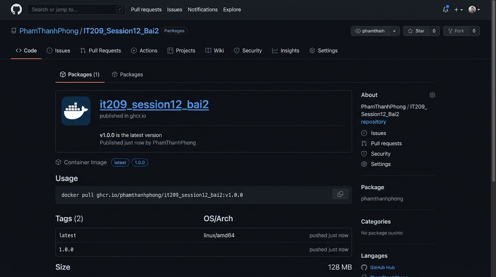

# IT209 - Session 12 - Bài tập 2: Tự động hóa đóng gói và phát hành Docker Image khi gắn Git Tag (v*.*.*)

- **Sinh viên:** Phạm Thanh Phong
- **MSSV:** N24DTCN120
- **Lớp:** IT209
- **Học phần:** IT209
- **Đường dẫn nộp bài:** `homework/session_12/ex2/`
- **Trạng thái:** Hoàn thành (100%)

---

## 1. Danh mục tệp tin trong thư mục bài tập

| Tên tệp tin | Mô tả chức năng |
| :--- | :--- |
| [.github/workflows/release.yml](./.github/workflows/release.yml) | **Tệp kịch bản GitHub Actions CD chính thức:** Kích hoạt khi gắn Git Tag `v*.*.*`, đăng nhập GHCR, trích xuất metadata và build-push Docker Image |
| [screenshots/github-packages-docker-v1.0.0.png](./screenshots/github-packages-docker-v1.0.0.png) | **Ảnh minh chứng nộp bài:** Giao diện GitHub Packages hiển thị gói Container Image `v1.0.0` phát hành thành công trên `ghcr.io` |
| [IT209_Session12_BT2_PhamThanhPhong_N24DTCN120.md](./IT209_Session12_BT2_PhamThanhPhong_N24DTCN120.md) | Báo cáo kỹ thuật chi tiết, phân tích kiến trúc CD, quy trình SemVer và giải thích các Action |
| [Dockerfile](./Dockerfile) | Tệp cấu hình Multi-stage Dockerfile đóng gói ứng dụng Spring Boot thành container image tối ưu |
| [.dockerignore](./.dockerignore) | Tệp cấu hình loại trừ các thư mục tạm (`build`, `.gradle`, git) khỏi Docker build context |
| [build.gradle](./build.gradle) & [settings.gradle](./settings.gradle) | Cấu hình dự án Spring Boot 3.2.5 và Gradle Wrapper |
| [gradlew](./gradlew) & [gradlew.bat](./gradlew.bat) | Bộ script thực thi Gradle Wrapper trên Linux và Windows |
| [src/](./src/) | Toàn bộ mã nguồn ứng dụng và bộ kiểm thử JUnit 5 |

---

## 2. Nội dung tệp cấu hình `.github/workflows/release.yml`

```yaml
name: Release Docker Image to GHCR

on:
  push:
    tags:
      - 'v*.*.*'

jobs:
  release-image:
    name: Build and Push Docker Image to GHCR
    runs-on: ubuntu-latest
    permissions:
      contents: read
      packages: write

    steps:
      - name: Checkout mã nguồn
        uses: actions/checkout@v5

      - name: Đăng nhập vào GitHub Container Registry (GHCR)
        uses: docker/login-action@v3
        with:
          registry: ghcr.io
          username: ${{ github.actor }}
          password: ${{ secrets.GITHUB_TOKEN }}

      - name: Trích xuất metadata (Tags, Labels) từ Git Tag
        id: meta
        uses: docker/metadata-action@v5
        with:
          images: ghcr.io/${{ github.repository }}
          tags: |
            type=semver,pattern={{version}}
            type=semver,pattern={{major}}.{{minor}}
            type=raw,value=latest

      - name: Đóng gói và đẩy Docker Image lên GHCR
        uses: docker/build-push-action@v5
        with:
          context: .
          push: true
          tags: ${{ steps.meta.outputs.tags }}
          labels: ${{ steps.meta.outputs.labels }}
```

---

## 3. Nội dung tệp `Dockerfile`

```dockerfile
# Multi-stage Dockerfile for Java Spring Boot
# Stage 1: Build Executable Fat JAR
FROM eclipse-temurin:17-jdk-alpine AS builder
WORKDIR /app
COPY gradlew .
COPY gradle/ gradle/
COPY build.gradle .
COPY settings.gradle .
COPY src/ src/
RUN chmod +x gradlew && ./gradlew bootJar --no-daemon

# Stage 2: Minimal Production Runtime
FROM eclipse-temurin:17-jre-alpine
WORKDIR /app
COPY --from=builder /app/build/libs/*.jar app.jar
EXPOSE 8080
ENTRYPOINT ["java", "-jar", "app.jar"]
```

---

## 4. Ảnh minh chứng kết quả phát hành trên GitHub Packages

Ảnh chụp màn hình tab **Packages** trên GitHub xác nhận gói Docker Container Image `it209_session12_bai2` phiên bản `v1.0.0` (kèm các tag tự động `1.0.0` và `latest`) đã được xuất bản công khai trên GitHub Container Registry (`ghcr.io`):



---

## 5. Hướng dẫn kiểm tra và kích hoạt quy trình phát hành

### 5.1. Đẩy mã nguồn chính lên GitHub
```bash
git add .
git commit -m "feat(release): setup automated docker image release workflow on git tag"
git push origin main
```

### 5.2. Gắn nhãn Git Tag và đẩy lên để kích hoạt Workflow
```bash
# Gán nhãn phiên bản theo chuẩn SemVer
git tag v1.0.0

# Đẩy nhãn lên GitHub từ xa
git push origin v1.0.0
```

### 5.3. Xác minh kết quả
1. Truy cập tab **Actions** trên GitHub: Workflow `Release Docker Image to GHCR` sẽ tự động khởi chạy khi nhận diện tag `v1.0.0`.
2. Truy cập mục **Packages** tại trang chủ Repository hoặc Profile: Xác nhận gói container image đã sẵn sàng với lệnh kéo image:
   ```bash
   docker pull ghcr.io/phamthanhphong/it209_session12_bai2:v1.0.0
   ```
